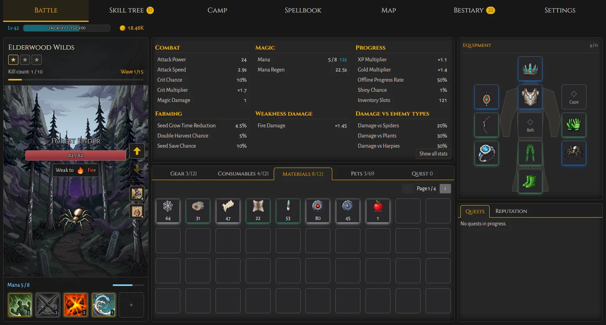
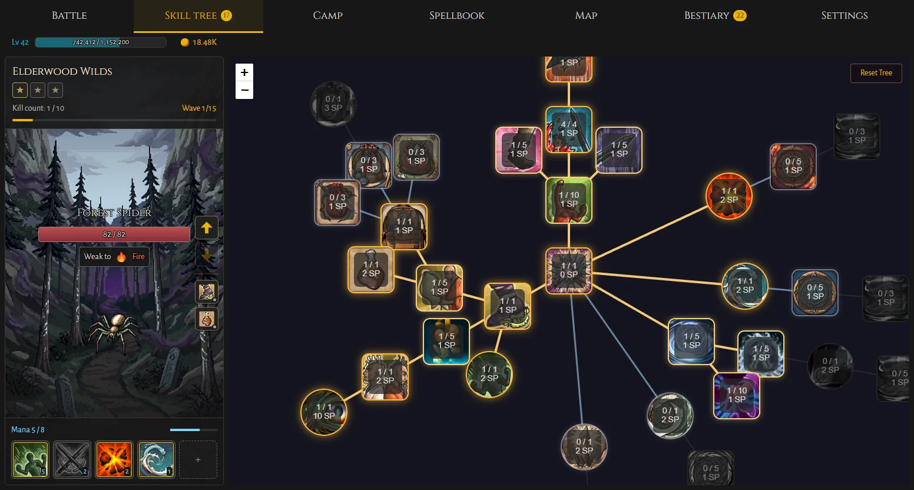
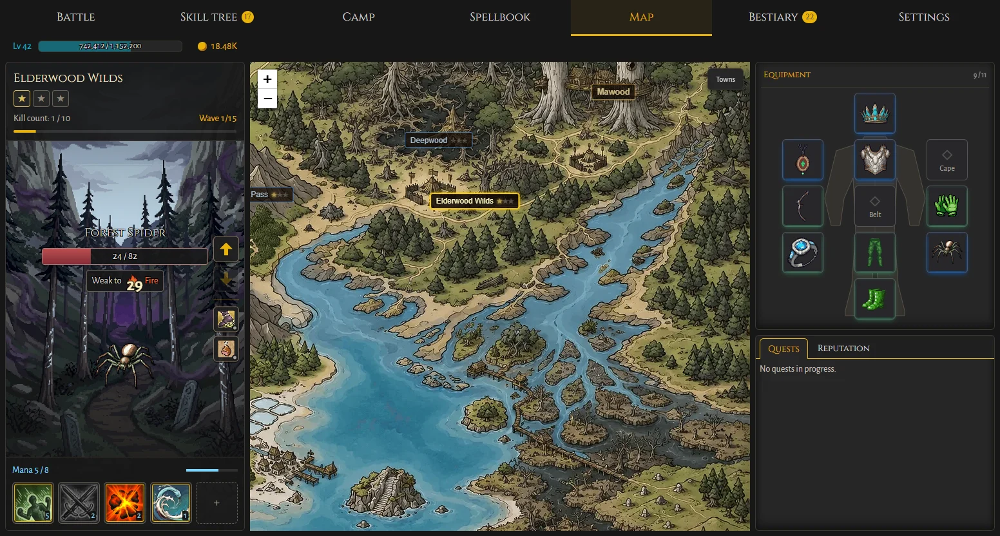
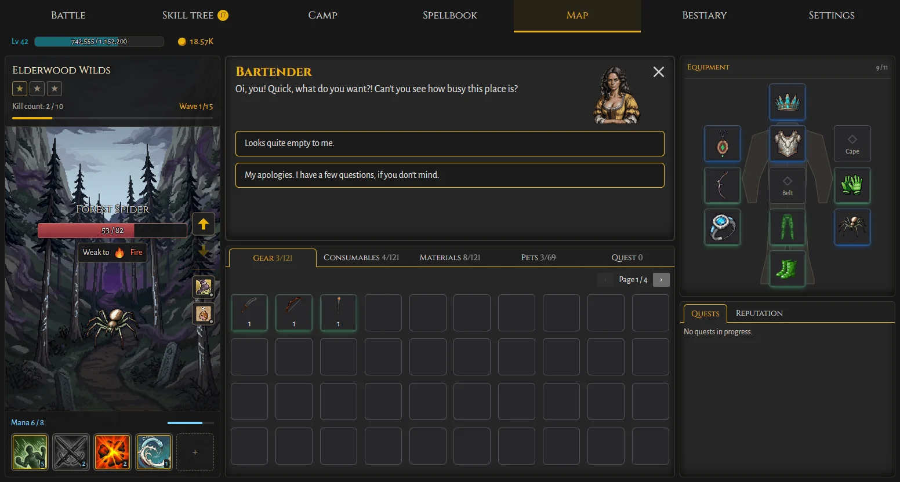
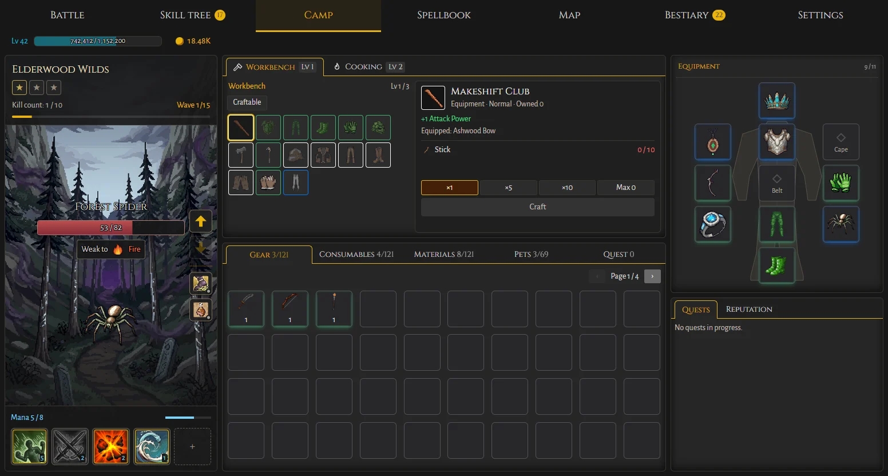
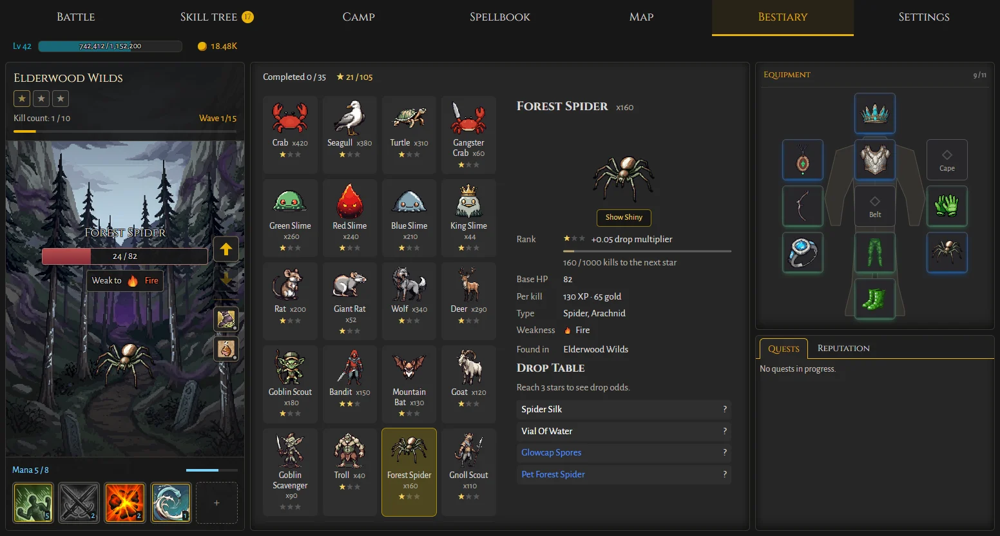
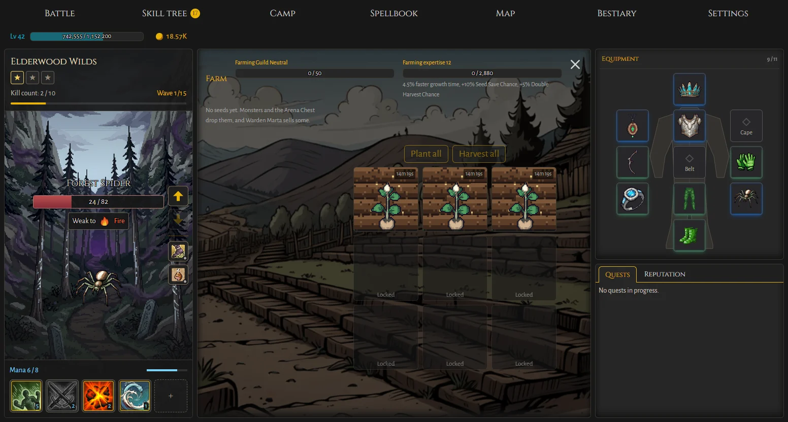

# Yet Another Idle RPG

A fantasy idle RPG that runs in your browser. Your character fights on their own, so you decide the build: where to fight, what to wear, which skills to learn and which spells to bring. Then come back later to see how far they got.



## What you do

- **Fight through zones.** Your character auto-attacks through waves of monsters, from Horseshoe Beach to the Upper Canopy. Exploit enemy weaknesses, beat bosses and earn mastery stars in each zone.
- **Shape your build.** Spend skill points on a radial skill tree that branches into exploration, physical damage and magic. Pay some gold to respec when you want to try something else.
- **Cast spells.** Learn elemental spells, slot them on your spell bar and match them to what you are fighting.
- **Collect gear, pets and shinies.** Fill your equipment slots, merge items at the Forge, and hunt for rare shiny monsters and the pets they drop.
- **Meet the locals.** Visit La Harpar, Mawood and Lirold, talk to NPCs, take on quests, earn reputation and browse their shops.
- **Craft and farm.** Cook food and brew potions at the Camp, make gear at the workbench, and grow crops for the Farming Guild.
- **Test yourself.** Take on the Combat Arena in Lirold.
- **Keep progressing offline.** Your character keeps earning for up to 24 hours while you are away, and your save stays in your browser.

## Screenshots

| | |
|---|---|
|  |  |
| **Skill tree:** branch out into exploration, damage and magic | **World map:** travel between zones and towns |
|  |  |
| **Towns:** talk to NPCs and pick up quests | **Camp:** craft gear, food and potions |
|  |  |
| **Bestiary:** track kills, weaknesses and drops | **Farm:** plant seeds and level your farming expertise |

## Run it

Needs [Node.js](https://nodejs.org/).

```bash
npm install
npm start          # http://localhost:4200
```

The game runs entirely in the browser, with no backend. It is built with Angular 20 and NgRx SignalStore, and its layout is designed for desktop screens.

## Scripts

| Script | What it does |
|---|---|
| `npm start` | Dev server, with cheats on (`window.dev` in the browser console) |
| `npm run build` | Production build to `dist/yari` |
| `npm run check` | Everything CI runs: validation, lint, tests and build |
| `npm run validate` | Checks game data, translations, asset paths and doc references |
| `npm run tile` | Regenerates world map tiles from the source art |
| `npm run test:assets` | Tests for the art generation pipeline |

## Docs

- [CHANGELOG.md](CHANGELOG.md) — what changed in each release.
- [AGENTS.md](AGENTS.md) — working rules and gotchas (for people and coding agents); [CLAUDE.md](CLAUDE.md) imports it.
- [GLOSSARY.md](GLOSSARY.md) — game terms.
- [docs/systems/](docs/systems/) — how each game system works today.
- [docs/ideas/](docs/ideas/) — design backlog.
